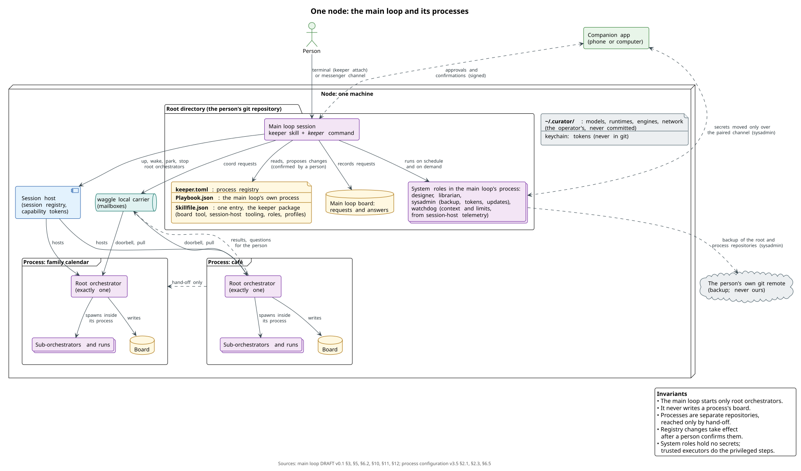
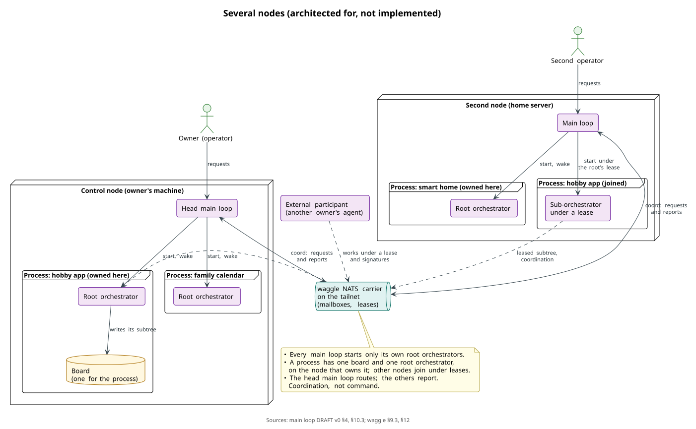
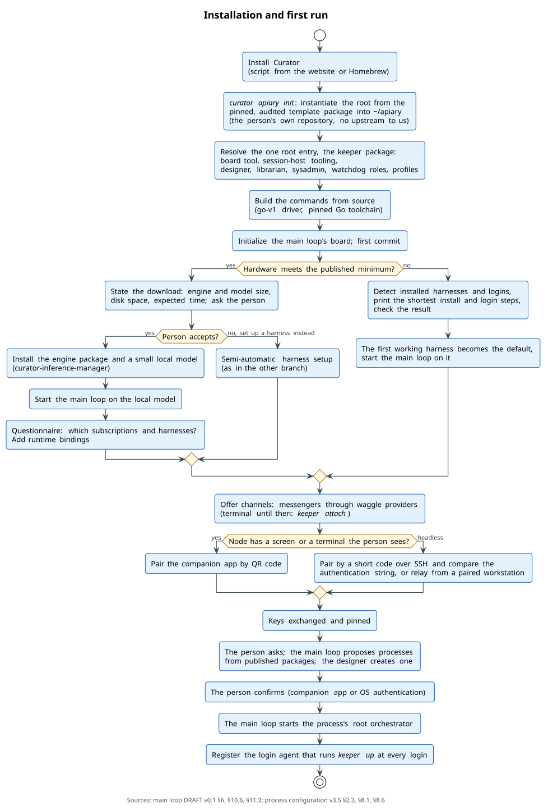
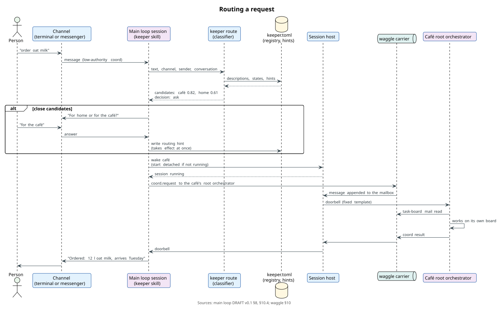
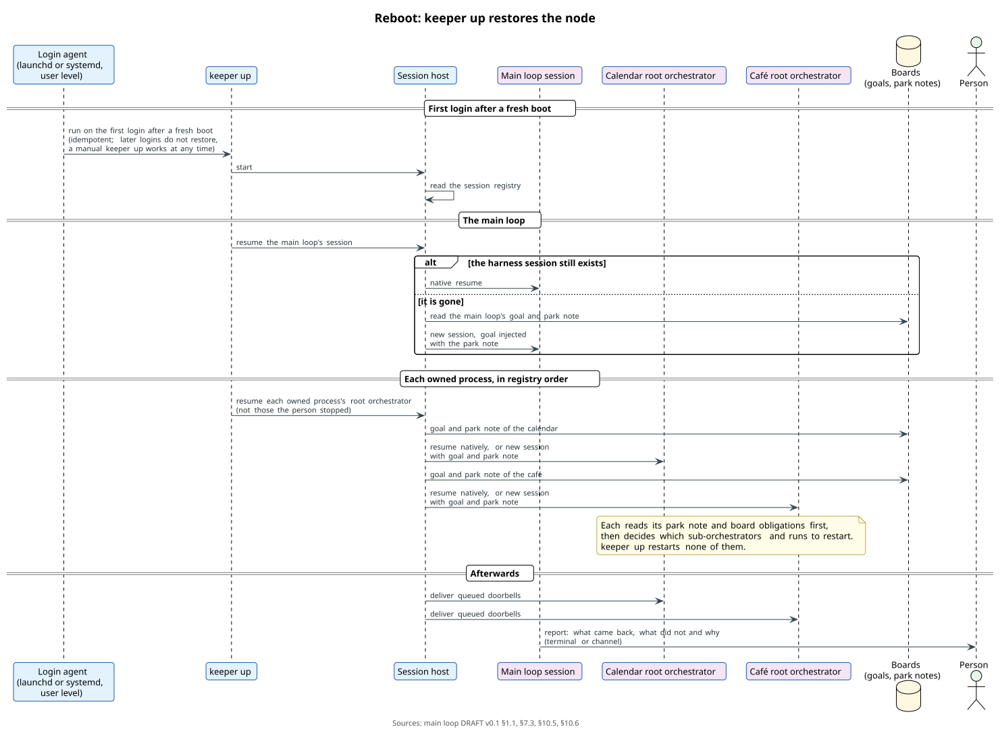

# Main loop: specification

Status: **DRAFT v0.1**, 2026-09-25. Not normative. Repository `curator-keeper`. Track: [`track.md`](track.md). Diagrams: [`../diagrams/`](../diagrams/). Earlier research: wiki `research/keeper-and-process-lifecycle.md` and `research/agent-loop.md`; roadmap line KP (`wiki/roadmap/ecosystem-roadmap.md` §5). Change log: §16.

One person runs several processes on one machine: a family calendar, the smart home, a hobby project, a small café. Each process has its own playbook, board and root orchestrator (curator-playbook `spec/process-configuration.md`). Something has to sit above them. It must:

- know which processes exist;
- take a request in plain words, such as "order oat milk", and decide which process it belongs to;
- start that process's orchestrator when it is not running, and wake it when a message arrives;
- bring results back to the person;
- ask the person what only a person may decide;
- bring the whole machine back after a reboot.

This specification describes that component, the **main loop**: precisely for one machine, and for several machines as far as the architecture must allow now.

## Names *(decided 2026-09-25)*

People see the beekeeping names; this specification's prose uses the technical terms. The map below applies wherever a name first appears. Command lines, directories and profiles use the beekeeping names, because people type them: `keeper`, `keeper hive …`, `~/apiary`, `hives/`, the profile `apiary`.

| Name | Technical term | What it is |
| --- | --- | --- |
| **apiary** | the whole system | every yard, hive and operator of one owner; one machine is a small apiary |
| **yard** | node | one machine of the apiary |
| **keeper** | main loop | the master orchestrator of a yard: one per node, and one head keeper when an apiary has several yards |
| **hive** | process | one domain: family calendar, smart home, café, a hobby project |
| **queen** | root orchestrator | exactly one per hive, started from outside the hive |
| **comb** | board | its cells are the tasks |
| **bee** | run | an agent at work, sub-orchestrators included |
| **wild bees** | external participants | agents of another owner working on one of our hives under leases and signatures |
| **nuc** | process package | the published playbook a new hive grows from |

Markers:
- *decided (date)*: the operator decided it;
- *proposed*: the author's proposal;
- **pending operator decision**: named where it applies.

Related documents:
- curator-playbook `spec/process-configuration.md`, DRAFT v3.5: processes, root orchestrators, hand-off, delegation, the operator's files and their confirmation, and the confirmation of every change to a process (§2.4);
- waggle `spec/waggle.md` with Amendment A1: messages, doorbell, carriers, leases, board acts;
- the session-host specification (`agent-session-host`);
- curator-spec Decisions 0010 (environment profiles), 0013 and 0019 (launch plans, one construction site) and 0021 (sessions enter through `curator run`, hosted through the `ax` contract);
- the agent-session-manager (`ax`) specification;
- curator-inference-manager `spec/inference-plane.md`.

---

## 0. The design on one screen

- **One main loop per node.** It manages the node's **processes** — each a project directory with its own `Playbook.json`, board and exactly one **root orchestrator** — and does no process work itself. *proposed; one root orchestrator per process, started from outside, decided (2026-09-24)*
- **The session host keeps orchestrators alive.** The main loop starts a process's root orchestrator through the session host, which keeps it running in the background. The root orchestrator runs its own process and spawns sub-orchestrators and runs inside it. *decided (2026-09-24)*
- **The main loop and orchestrators talk over waggle.** A request goes in as a message, the session host rings the doorbell, and the orchestrator pulls the message; reports come back the same way. Child runs never talk to the main loop. *proposed*
- **A registry points at separate repositories.** The main loop keeps a **process registry**, `keeper.toml`, in its own **root directory**. Processes are separate repositories the registry points at, never git submodules. Adding, removing or moving a process is authority-bearing and takes effect after a person confirms it. *proposed*
- **Installation is detached from us.** The root is instantiated from a pinned, audited template package and becomes the person's own repository with no upstream to us. Our code reaches a node only through the Curator registry, audited and pinned. *decided (2026-09-25)*
- **One root package installs everything.** The root's `Skillfile.json` names one package, the keeper package; its dependencies bring the board tool, session-host tooling, the system roles and the profiles. One tool serves many boards. *proposed; the operator's direction (2026-09-25)*
- **`keeper up` is the single entry point.** It brings a node up — at login, after a reboot, or by hand — and resumes every hive from its goal and park note. `keeper down` parks everything; `keeper estop` stops everything at once. *proposed*
- **Routing** follows a fixed order *(decided 2026-09-24)*:
  1. an explicit reference wins;
  2. then a channel bound to a process;
  3. then one confident candidate;
  4. close candidates get one short question, and the answer becomes a visible routing hint;
  5. no candidate leads to the process designer;
  6. a request for two processes is split.

  A fast classifier with typed outputs fits; the specification does not prescribe one.
- **The main loop is a role plus a module.** The role is a skill any harness can run; the module is the `keeper` command and library that does the deterministic work. The minimal system runs entirely on existing harnesses. Our own lightweight loop is optional and later. *proposed*
- **Processes are created, not configured by hand.** The main loop matches a request against published templates first. When none fits, the **process designer** generates a playbook, always starting from the simplest process that works. The **librarian**, a small process of its own on a timer, proposes merging near-duplicates and merges only after the person approves. *decided (2026-09-24)*
- **System roles keep the node healthy.** The **sysadmin** backs the apiary up to the person's own remotes, restores it, keeps an inventory of tokens and updates skills. The **watchdog** watches context and provider limits and parks sessions before they run out. *decided in direction (2026-09-25); protocols proposed*
- **The person talks and approves remotely.** Conversation goes through channels: the terminal first, then messengers through waggle providers. Approvals go through a **companion app** — on the phone in the common case, or on another computer — or through the operating system's user authentication on the machine. *decided (2026-09-24)*
- **Several nodes are architected for, not implemented now:** one process worked from several nodes under leases, unrelated processes on several nodes under a head main loop, several operators, and external participants. *proposed*

## 1. Goals, non-goals and principles

Goals:

1. A person reaches every process on the node through one conversation, without knowing how the processes are organized.
2. A new kind of work becomes a new process without hand-editing configuration.
3. Background orchestrators run autonomously, survive restarts and reboots, and are observable on demand.
4. What only a person may decide reaches the person wherever they are, and the answer carries proof that the person gave it.
5. Nothing in the one-node design blocks several nodes, several operators or external participants later.

Non-goals of this draft:
- the process model (curator-playbook);
- message formats, signatures and carriers (waggle);
- how sessions are hosted (the session-host specification);
- our own agent loop (wiki `research/agent-loop.md`);
- the companion app's implementation (§11.3 lists what the main loop needs from it).

### 1.1 Principles *(proposed)*

1. **The journal is the state; a session is a cache.** Everything a process needs to continue lives in its repository and on its board: the goal, park notes, decisions, runs, Change Requests. A session can be compacted, restarted, replaced by another harness or lost in a reboot without losing the process. Park notes (§10.5), restore (§10.6) and compaction hand-offs (§12.2) all follow from this.
2. **Authority only narrows.** Every nested or delegated authority is a subset of its parent's: operator, main loop, root orchestrator, sub-orchestrator, run. A delegation never exceeds what its grantor may do, and a sub-orchestrator's pool never exceeds its parent's.
3. **Transport is not authority.** A tailnet identity, a relay, or a messenger account shows only where a message came from. What it may do is decided by signatures, the roster and the process rules.
4. **Privileged operations happen outside agent shells.** Secrets — tokens, signing keys, credentials — never enter an agent's environment. An agent asks for a privileged operation (push a backup, sign, publish), and a trusted executor performs it after authorization: the kernel executor, the sysadmin's tooling, or the companion app.
5. **The emergency stop belongs to the authority plane.** `keeper estop` is an operator act that needs a person present. The session host and the kernel execute it; no model mediates it (§10.3).

## 2. Terms

| Term | Meaning |
| --- | --- |
| node | one machine with its operator's installation |
| main loop | the component this specification describes; one per node |
| process | one domain of work: a project directory with `Playbook.json`, `Skillfile.json`, `task-board.config.json` and a board (curator-playbook §2.1); a composition of several playbooks on one board counts as one process |
| root orchestrator | the single orchestrator session of a process that is started from outside it: the process's root role (curator-playbook §4.4) |
| sub-orchestrator, run | agents that a root orchestrator spawns inside its own process |
| process registry | the main loop's list of the node's processes (§5.2) |
| process package | a published playbook: a `curator-playbook-<purpose>` skill collection (curator-playbook §8) |
| keeper package | the one package the root installs: the main loop's orchestrator skill, its template and its dependencies (§6.2) |
| session host | the node's component that starts, keeps and wakes long-lived agent sessions (the session-host specification; today task-board's session daemon `tb-sessiond`) |
| kernel | task-board's own code, which keeps boards and runs deterministic steps without a model |
| operator | a person who administers the node and answers what only a person may decide |
| external participant | an agent of another owner that works on one of our processes under a lease and signatures |
| companion app | the operator's app that renders requests for approval and signs them (§11.3) |
| park note | what a session writes down when it stops, bound into its goal so that the next start reads it first (session-host specification) |

## 3. One node

### 3.1 Who does what

| Component | Does | Does not |
| --- | --- | --- |
| main loop | keeps the registry; takes the person's requests and routes them; creates processes through the designer; starts, wakes, parks and stops root orchestrators; relays results and questions; runs its own small process with the system roles (§5.1, §12) | write any process's board; spawn a run inside a process; change a process's `Playbook.json` except by a committed change the person confirms |
| session host | starts sessions in a given directory with a given profile and goal; keeps them alive while detached; lets people attach; rings the doorbell; emits events; enforces who may act on which session (§10.2) | decide what a session does |
| root orchestrator | runs its process: plans, spawns sub-orchestrators and runs, integrates, asks for people through the main loop | write another process's board |
| sub-orchestrators, runs | the work inside one process, under the root orchestrator's leases | talk to the main loop |
| operator | answers and approves; confirms authority-bearing changes; is the only one who may pull the emergency stop | edit configuration by hand (possible, never required) |

### 3.2 Invariants

1. **One root orchestrator per process, started from outside.** *decided (2026-09-24)*
   - The main loop starts only the root orchestrator of a process; the root orchestrator starts everything else inside the process.
   - Today's board enforces this already: it has one primary-goal owner. A second primary launch either reattaches the running session or, for another provider, is refused with `session_provider_conflict` (skill-project-management `docs/claude-goal-runtime.md`).
2. **The main loop does no process work.** It never writes a process's board and never spawns a run inside a process. It reaches a process only through the process's root orchestrator. *proposed*
3. **Processes are isolated.** An orchestrator writes only its own board, and inside it only its leased subtree. Another process is reached only by hand-off (curator-playbook §6.5, §7.2). *decided*
4. **The registry is authority-bearing** (§5.4). *proposed*
5. **What only a person may decide goes to a person.** It travels through the main loop, and the answer is recorded with proof wherever the process requires it (curator-playbook §4.2). *decided*

### 3.3 Example

One node carries five processes: a family calendar, the smart home, a hobby app, a small café, and the main loop's own process. The person writes: "move Saturday's dentist to 11 and order oat milk".

1. The main loop splits the request (§8.2).
2. It sends the first half to the calendar's root orchestrator and the second to the café's:
   - the café's orchestrator is not running, so the main loop starts it first;
   - the calendar's orchestrator is parked, so the main loop wakes it (§10).
3. A purchase above the café's delegated limit waits for the operator's approval on the phone (§11.2).
4. The main loop answers with both results.



## 4. Several nodes *(proposed; architected for, not implemented)*

A system outgrows one node in four ways, and the design keeps each open:

1. **One process, several nodes.** One project is developed from two machines, each with its own main loop.
   - The process keeps one board and one root orchestrator, on the node that owns it.
   - Orchestrators on other nodes work leased subtrees and coordinate over waggle (waggle §12, milestone CM2).
   - The owning node's registry lists the process as owned. The other nodes list it as *joined*: they may start sub-orchestrators under a lease, never a second root orchestrator.
2. **Unrelated processes, one system.** A second machine carries its own processes, such as a home server with the smart home, and still belongs to the owner's system.
   - One main loop is the **head main loop**, on the owner's control node. The others report to it over waggle (`coord` requests and reports) and take the requests it routes.
   - A request the head routes to a process on another node travels as a waggle message to that node's main loop, which delivers it to the root orchestrator.
   - The relation is coordination, not command: each node's main loop still starts and stops its own root orchestrators.
3. **Several operators.** Several people administer one system, possibly in a hierarchy. Operators are waggle principals (waggle §3), and who may confirm what is policy (curator-playbook §2.3, §4.2). An operator hierarchy is an open question (§15).
4. **External participants.** Agents of another owner work on one of our processes under a lease and signatures, admitted by that process's roster (waggle milestone CM4).

Three choices now keep all four ways open without a redesign:
- every registry entry names the process's owning node and a stable process id (§5.2);
- every message between a main loop and an orchestrator is a waggle message, even on one node, so crossing machines changes only the carrier (§10.4);
- processes are separate repositories, so a process can move to another node or be cloned there (§5.3).



## 5. The root directory

### 5.1 Layout *(proposed)*

```
~/apiary/                      the main loop's root: the person's own git repository, no upstream to us
  Skillfile.json               one entry: the keeper package (§6.2)
  Skillfile.lock.json          the exact versions of everything it resolved
  Playbook.json                the main loop's own process: requests, routing, "a person is needed", system roles
  keeper.toml                  the process registry (§5.2)
  task-board.config.json       where the main loop's board lives
  .task-board/                 the main loop's board: requests and what became of them
  .gitignore                   ignores hives/
  hives/                       default place for process directories, each its own repository
    family-calendar/           Playbook.json, Skillfile.json, task-board.config.json, .task-board/
    cafe/
```

- **The main loop has a process of its own.** Its elements are the person's requests and the questions the main loop asks, and its workflows track each request from arrival to answer. The system roles run in it: the designer, the librarian on a schedule, the sysadmin and the watchdog (§9, §12). So the main loop's work is visible on a board like any other process's.
- **Process directories may live anywhere.** `~/work/relux-app` is as good as `~/apiary/hives/relux-app`; the registry records the path.

### 5.2 The process registry *(proposed)*

```toml
[processes.family-calendar]
id          = "proc-7f3a2c"                  # stable, never reused
path        = "hives/family-calendar"        # relative to the root, or absolute
remote      = "git@github.com:example/family-calendar.git"   # optional: the person's own remote (§12.1)
node        = "home-mac"                     # the owning node
role        = "calendar-orchestrator"        # the root orchestrator's role alias
harness     = "claude"                       # optional: this process's default harness (§7.4)
description = "The family's appointments, school events and reminders"
channels    = ["telegram:family-chat"]       # conversations bound to this process

[processes.cafe]
id          = "proc-19be04"
path        = "hives/cafe"
node        = "home-mac"
role        = "cafe-orchestrator"
description = "The café: purchasing, stock, supplier orders, hand-off to bookkeeping"

[[hints]]
text    = "milk on weekdays, from the work phone"
process = "cafe"
source  = "the person's answer, 2026-09-24"
```

- `id` is stable and never reused. `node` names the owning node; a joined process (§4) says `joined = true`.
- `remote` is always the person's own remote (their GitHub, GitLab or any git server), used for backup and for cloning the process onto another node (§12.1). It never points at us.
- `description` is what routing reads, so it says what the process handles in the person's words. The designer writes it and the person may edit it.
- The registry holds declarations only. Which sessions run, and in which state, is runtime state the session host keeps, never committed.

### 5.3 Separate repositories, not submodules *(proposed)*

Each process is its own repository, or a plain directory when it does not use git (curator-playbook §2.4). The root only points at it, for five reasons:

- **A submodule pins a commit in the parent.** Every change a process lands would need a second commit in the root to move the pin, or the root would describe a stale process. The kernel reads a process's rules from the head of that process's own default branch (curator-playbook §2.4); a pinned submodule commit is exactly what that rule avoids.
- **A submodule sits on a detached HEAD by default.** Agents and tools that commit into it lose work or commit off-branch.
- **Processes differ in owner, visibility and hosting.** A family calendar stays private, a hobby app may be public, and a café's books may live with an accountant. A submodule ties them all to one parent's access.
- **A process may not use git at all.**
- **A process moves between nodes, or is cloned to another node, on its own** (§4).

The root ignores `hives/`, so the default location nests the processes on disk without making them part of the root repository.

### 5.4 Authority of the registry *(proposed)*

- **Which entries are authority-bearing.** These entries decide where requests and authority go:
  - adding, removing or moving a process;
  - changing a process's path, remote, owning node or root role;
  - binding a channel to a process.

  They follow the rule curator-playbook applies to a process's configuration. The main loop may write them, as a commit to its root repository, but they take effect only after a person confirms the new version (§11.2).
- **Which are not.** Descriptions, routing hints and a process's default harness only choose where and how a request is offered; every process still applies its own rules. The main loop writes hints from the person's answers (§8.3), and they take effect at once.

## 6. Installation from zero

### 6.1 Detached from us *(decided 2026-09-25)*

- **The root is instantiated, not cloned.** Curator copies a template package — pinned by its package identity and audited like any skill — into `~/apiary`, and the person's first commit starts the history. No remote pointing at us is added, and nothing is ever pulled from our repositories. So no repository of ours can push a change into a node.
- **Our code enters a node only through the Curator registry.** Every skill and command a node runs arrives as an audited package version pinned in the root's lock. The template, too, is such a package: a template update is a new version the person adopts, not a pull.
- **The main loop and the root orchestrators update their own skills.** When the registry publishes a new audited version of the keeper package or of a process's skills, the main loop (for the root) or a root orchestrator (for its process) proposes the update. It installs when the project's skill policy or a delegation allows it (curator-playbook §8.6), and the change it makes to a process waits for confirmation like any other (curator-playbook §2.4).

### 6.2 One root package installs everything *(proposed; the operator's direction, 2026-09-25)*

The root's `Skillfile.json` names one entry: the keeper package. Its orchestrator skill carries the main loop's template and declares everything else as dependencies (curator-spec `protocol/core.md` §4.4):

| Dependency | Mode | What it brings |
| --- | --- | --- |
| task-board | `runtime`, narrowed to the `task-board` command | the board tool: the kernel, spawns, the session daemon today |
| session-host tooling | `runtime`, narrowed to its commands | the session host, until it ships inside task-board's successor |
| designer, librarian, sysadmin, watchdog | on-demand role skills (curator-spec issue #91) | the system roles (§9, §12) |
| profiles | package content (§13.3, a proposal) | `apiary` and the base profiles the node's sessions launch with |
| waggle tooling | `runtime`, once waggle CM1 ships | mail, doorbell, providers |

- **One resolve installs everything.** Resolving the one entry installs the whole closure, and the lock pins every version.
- **One version to update.** Updating the keeper package updates the set.
- **One tool, many boards.** The `task-board` command is installed once per node: a Curator command shim has exactly one owner and one version on a node. Every process's board is data in that process's own repository (`.task-board/`). The keeper package and every process's orchestrator skill declare the board tool as a dependency so that Curator can check they agree; a process whose skills demand another version of the tool is refused with both requirement chains, never installed beside it.

### 6.3 Built from source *(decided 2026-09-25)*

- The `keeper` command is built by Curator's `go-v1` build driver from the package's audited source snapshot, as Curator builds other commands (curator-spec Decisions 0004, 0005).
- The installer provisions a pinned Go toolchain for that; Curator's toolchain policy decides which versions it accepts (curator issue #87).
- Later, signed prebuilt binaries: Curator verifies their signature and provenance against the audited source identity, and source builds remain the fallback.

### 6.4 The steps *(proposed; the flow decided in outline on 2026-09-24)*

1. **Curator.** A script from the website, or Homebrew, installs Curator, the way agent vendors install their harnesses.
2. **The root.** `curator apiary init` instantiates `~/apiary` from the template package (§6.1), resolves the keeper package (§6.2), builds its commands (§6.3), initializes the main loop's board, and makes the first commit.
3. **A model to talk with.** The main loop needs a model before it can talk. Curator checks the hardware against the minimum requirements published with the model registry, and the installation takes one of two branches:
   - **(A) The hardware suffices.** Before downloading anything, the installer states what it will fetch — the engine and the model, their size in gigabytes, the disk space needed and the expected time — and asks. The person may take branch B instead. On yes, Curator installs an inference engine package and a small local model through curator-inference-manager (`~/.curator/engines.toml`), and the main loop starts on it at once. It greets the person with a short questionnaire: connect subscriptions? which harnesses (Claude Code, Codex, Muse Code, others)? Each yes becomes a runtime binding in `~/.curator/runtimes.toml`.
   - **(B) Semi-automatic harness setup.** The installer detects the popular harnesses already installed and whether each is logged in. For each missing one it prints the shortest path — the install command and the login command — and checks the result. The first harness that works becomes the node's default harness (§7.4), and the main loop starts on it.

   Later, harnesses may be authenticated through the chat, with the device codes a harness prints relayed to the person. The first versions log in by hand.
4. **Channels.** The main loop offers to connect messengers (Telegram, WhatsApp and others) through waggle providers, so the person can write to it from the phone (§11.1). Until then the terminal is the channel: `keeper attach`.
5. **The companion app.** The node and the person's app pair (§11.3): by a QR code when the node has a screen or a terminal the person sees, and otherwise by a headless method. From then on, approvals, delegations and confirmations reach the person anywhere.
6. **The first process.** The person asks: "what can you do?", "keep our family calendar". The main loop proposes processes from the published packages, and the designer creates the chosen one (§9).
7. **The login agent.** The installer registers a user-level login agent that runs `keeper up` at every login (§10.6).

What exists today: Curator, `curator run`, task-board with its session daemon, and `task-board spawn`. Everything else in this list is planned.



## 7. The main loop: a role plus a module

### 7.1 The role *(proposed)*

The main loop's session runs a harness — Claude Code, Codex, or any other with a session-host adapter — with the keeper skill as its identity. The skill arrives through Curator's skills launch channel (curator-playbook §8.1). It says:
- how to talk with the person, and when to ask and when not to;
- how to route, and when to create a process;
- which `keeper` command does each step.

The model decides; the command does.

### 7.2 The module *(proposed)*

The `keeper` command and its library do the deterministic work, with `--json` output for agents and people alike. Commands that act on sessions go through the session host, which checks who may do what (§10.2).

| Command | Does |
| --- | --- |
| `keeper up [--harness H]` | brings the node up: the session host, the main loop's session, and every owned hive's queen, each resumed from its goal and park note (§10.6); does nothing for what already runs |
| `keeper down` | parks every session, queens first and the main loop's session last (§10.5); the session host keeps running |
| `keeper ls` | the node's sessions: the main loop, each queen, their sub-orchestrators, with state, harness and last activity |
| `keeper attach [target] [--view]` | attaches the terminal to a session; without a target it opens a picker over the session host's registry (§7.5); `--view` watches without typing |
| `keeper park <target>`, `keeper stop <target>` | parks or stops a session: a hive name means its queen; a session id means that session |
| `keeper estop` | the emergency stop (§10.3) |
| `keeper status` | the node: processes, sessions, questions waiting for the person |
| `keeper hive list`, `keeper hive show <hive>` | the registry, with each process's state: running, parked, stopped, unreachable |
| `keeper hive add`, `remove`, `move` | proposes a registry change, which takes effect after confirmation (§5.4) |
| `keeper route "<text>" [--channel C] [--from P]` | the candidate processes with scores and reasons (§8) |
| `keeper create --template <package>` or `--design "<text>"` | creates a process (§9.3) |
| `keeper wake <hive> [--message …]` | starts or wakes a queen and delivers a message (§10) |

`keeper attach` shows the session's harness exactly as it runs — the Claude Code or Codex interface — so the person can watch it and type into it. Detaching leaves it running.

### 7.3 What `keeper up` runs: the launch nesting *(proposed)*

A session starts through five layers, each with one job:

1. **`curator`** is the umbrella command. `curator run` dispatches to the `curator-run` provider, found on a trust root.
2. **`curator-run`** resolves the environment profile into a fragment: the harness's managed home (`CLAUDE_CONFIG_DIR`, `CODEX_HOME`), the root context, the skills, the MCP set and the system-prompt channel (Decision 0010).
3. **The agents-management launch plane** turns the harness, model and effort into argv and environment through the harness's plugin. `curator-run` composes that plan and the fragment into exactly one launch plan (Decisions 0013, 0019).
4. **The session host** receives the plan and hosts the process (Decision 0021, through the `ax start --launch-plan` contract; task-board's session daemon bridges it today). It binds the session to the process's primary goal and injects the goal, with the park note if there is one.
5. **The harness** runs in the hive's directory with its managed home, detached, until someone attaches.

`keeper up` for a hive is layers 1–5 with the hive's directory, the hive's profile and the harness chosen by §7.4.

### 7.4 Which harness *(proposed; the operator's direction, 2026-09-25)*

- **Any harness with a session-host adapter** can run the main loop or a queen: Claude Code, Codex, Muse Code, a harness bound to a local engine.
- **The node's default harness** is the first one the person set up (§6.4 step 3), recorded in the main loop's runtime state.
- **Overrides**, from the most specific: a flag on the command (`keeper up --harness codex`), a process's `harness` in the registry, the operator's bindings in `~/.curator/models.toml` for the role (curator-playbook §2.3).

### 7.5 The session registry and the picker *(proposed)*

- The session host keeps a registry of the sessions it hosts: id, process, role, harness, state, and how to resume it (a native resume identity or the goal and park note).
- `keeper attach` without a target opens a small terminal picker over that registry. Choosing a session attaches to it. Each harness resumes differently, and the session host's adapters hide the difference, as task-board's session daemon already does for Claude Code and Codex.
- Root orchestrators and sub-orchestrators are attachable; short-lived runs are observed through their transcript.

### 7.6 Skills first *(proposed; the operator's direction on 2026-09-24, not a decision)*

The main loop's capabilities reach a harness as skills installed through Curator: a skill appears in every harness Curator manages, and profiles carry it into launches. An MCP server needs configuration inside each harness. Curator may manage that later (Decision 0010 lists MCP among future profile surfaces), and the module can serve both.

Not every role has a command:
- the board is a command the orchestrator skills depend on;
- the keeper skill exports `keeper`;
- most process roles have none.

### 7.7 Our own loop later *(proposed)*

The minimal system runs entirely on existing harnesses. Our own lightweight loop (wiki `research/agent-loop.md`) becomes worth building for three things, none of them required now:
- an always-on front on a small local model, cheaper than a full harness session kept idle; a harness bound to a local engine through a profile and curator-inference-manager already gets most of that, since engines install as packages and weights download through the inference manager;
- restricted worker agents, which tool overriding in existing harnesses may cover first;
- sub-agent completion delivered natively.

## 8. Routing and collisions *(order decided 2026-09-24; hint records and output shape proposed)*

### 8.1 Inputs

- the request text;
- the channel and thread it came through;
- who sent it;
- the recent conversation;
- each process's description and state;
- the routing hints.

### 8.2 Order

1. **An explicit reference wins.** The person names the process ("for the café"), or answers inside a process's thread.
2. **A channel bound to a process** routes there: a message in the café's group goes to the café.
3. **One confident candidate.** The classifier ranks the processes, and one scores above the threshold with a clear margin.
4. **Several close candidates** get one short question, such as "for home or for the café?". The answer becomes a routing hint (§8.3).
5. **No candidate** leads to the designer: the main loop proposes a new process (§9).
6. **A request for two processes** is split into two requests, each routed on its own. The main loop says so and reports both results.

### 8.3 Routing hints

- A hint records what an answer taught: `text`, `process`, `source`, and when it was created (§5.2).
- Hints are data, not model memory, so a replaced front or another operator's main loop routes the same way.
- The main loop writes hints from the person's answers. The person sees them (`keeper hive show`) and can remove them.

### 8.4 The classifier

The specification does not prescribe how candidates are scored.

Fast classifiers of the "System One" kind fit well. They take unstructured text and a fixed set of options and return only a typed decision with calibrated confidence. One example is [Jev](https://www.producthunt.com/products/jev-2) by TypeSafe AI, in early access since 2026-09-15: roughly 70–500 ms per decision, and far cheaper than a generative model. The fallback is a small generative model with schema-constrained output.

Whatever does the scoring, `keeper route` returns the same shape:

```json
{ "candidates": [ { "process": "cafe", "score": 0.82, "reasons": ["mentions supplies", "hint: milk on weekdays"] },
                  { "process": "home", "score": 0.61, "reasons": ["mentions groceries"] } ],
  "decision": "ask", "question": "For home or for the café?" }
```

`decision` is `route`, `ask`, `split` or `design`. The threshold and the margin are the main loop's policy.



## 9. The life of processes *(outline decided 2026-09-24; details proposed)*

### 9.1 Templates first

When no process takes a request, the main loop matches it against published process packages (`curator-playbook-*`: their purpose, entity types and example requests) and against the node's own templates. A match proposes a new process from that template, which the designer instantiates with `extends` (curator-playbook §7.1).

### 9.2 The process designer

- **It always exists.** It is installed with the root (§6.2).
- **It writes a `Playbook.json` when no template fits**, extending the closest template where there is one. The validator checks it (`playbook validate`), and the refuter may challenge it.
- **It starts from the simplest process that works:** the fewest states, roles and fields that carry the request. It adds complexity only on evidence: repeated escalations, recurring manual steps, reviews that keep failing. *decided (2026-09-24)*
- **It keeps processes alive.** The main loop measures each process: throughput, rework, time spent waiting on people, escalations. The designer proposes improvements the way a bug on a board is fixed: a change to the process's `Playbook.json`, validated, then confirmed (§9.6). *decided (2026-09-24)*

### 9.3 Creating a process

1. The designer drafts the project directory: `Playbook.json`, `Skillfile.json`, `task-board.config.json`, a board, and a description for the registry.
2. The draft passes the validator, and the skills the process needs are installed (§9.5).
3. The draft is committed in the new repository, and the registry entry is written.
4. The person confirms (§11.2). One confirmation covers the process's configuration and the registry entry together.
5. The main loop starts the root orchestrator (§10.1) and hands it the request that led here.

### 9.4 The librarian

- **A system role in the main loop's own process**, on a schedule (daily or every two days) in the main loop's `Playbook.json` (curator-playbook §6.6).
- **Finds near-duplicates.** It compares the node's playbooks by structure (the semantic digests and structure of their resolved workflows) and by meaning.
- **Drafts a generalized template.** What the duplicates share becomes a template they `extend`, their differences become slots and fields, and running elements get migrations.
- **Merges only after approval.** The main loop proposes the consolidation to the person, and the librarian merges only after the person approves. *decided (2026-09-24)*

### 9.5 Skills a process needs

- **Reuse before writing.** The designer and the orchestrators look for existing skills before writing their own: a CRM integration for a café, a supplier's portal, a calendar provider. The source is the Curator registry, whose skills pass Curator's audit.
- **Audited skills install autonomously when allowed.** An audited skill from a trusted registry installs without asking when policy or a delegation allows it (curator-playbook §8.6); otherwise the person confirms it.
- **Skills from unknown sources are refused by default,** like software from unidentified developers on macOS. Only a deliberate operator setting that states the risk enables them. The recommended path is to submit the skill for audit, through the main loop, so that it enters the Curator registry. *decided (2026-09-24)*
- **Using a skill's tool stays the process's decision.** The tool is bound and enabled in the process's `Playbook.json` (curator-playbook §8.5).

### 9.6 Changing a process *(decided 2026-09-24)*

- A change to a process's rules is a commit to the default branch of the process's repository (curator-playbook §2.4). No pull request and no hosting service is required; a project that uses one may keep it.
- A committed change takes effect only after a person confirms it (§11.2). curator-playbook DRAFT v3.5 §2.4 defines the rule: the default is that every change to the process's resolved configuration — its `Playbook.json`, the templates it resolves, the tool providers it binds and its waggle roster — waits for one of the process's confirmers; the kernel runs the last confirmed version in full meanwhile, and one confirmation covers every pending change. Whether a classified variant lets changes that cannot move authority take effect on commit is pending the operator (curator-playbook §17.3 item 13).
- A process without git applies a new version only through the same confirmation.

## 10. Supervision and communication

### 10.1 Starting a root orchestrator *(proposed)*

- **Start.** `keeper wake` or `keeper up` on a process with no running root orchestrator asks the session host to start one through the launch nesting (§7.3): the process's directory and profile, detached, bound to the process's primary goal.
- **No second start.** The board's single primary-goal slot refuses a second one.
- **Record.** The session host records the session in its registry (§7.5); nothing about running sessions is committed.

### 10.2 Who may act on which session *(proposed)*

| Actor | Wake | Park | Stop | Attach with control | Attach to view | Emergency stop |
| --- | --- | --- | --- | --- | --- | --- |
| operator | every session | every session | every session | every session | every session | yes, and only the operator |
| main loop | registered queens | registered queens | registered queens, only with a person's confirmation or a delegation | no | queens | no |
| root orchestrator | its own sub-orchestrators and runs | the same | the same | no | its own sub-orchestrators | no |
| sub-orchestrator | its own runs, inside its pool | the same | the same | no | no | no |
| run | nothing | nothing | nothing | no | no | no |

- **Authority only narrows** down the table (§1.1).
- **Before waggle CM2** the session host enforces the table with per-session capability tokens: every session it starts receives a token that names exactly the sessions it may act on and how. The operator's commands come from the operator's terminal outside every agent session. That is a guardrail against well-behaved agents, not a boundary, because everything runs as one operating-system user — except the emergency stop, which needs the person present (§10.3).
- **From CM2** these acts are signed waggle `cmd` messages, in the `halts` category that a process's signature policy may cover (curator-playbook §4.2). The session host verifies each against the roster and the sender's session certificate before executing it, and the orchestrator's model is only informed (waggle §5).
- **The operator's command line:** `keeper ls`, `keeper stop`, `keeper park`, `keeper estop`. Today: `task-board session list`, `task-board session stop SES-…` (it stops a session without clearing its goal), and `task-board spawn directive <RUN> cancel` for a run.

### 10.3 The emergency stop *(proposed)*

- **A name nobody types by accident.** `keeper estop` asks for the phrase "EMERGENCY STOP" and the operator's presence: operating-system user authentication on the node or the companion app (§11.2).
- **What it does, at once and without a model:**
  - the kernel writes a snapshot on every board: runs in flight, Change Requests awaiting review or integration, obligations;
  - every run is stopped so that it can resume, where the harness allows it;
  - every session on the node is stopped; no goal is cleared;
  - the scheduler (`task-board tick`) and tool invocations pause.
- **Coming back** is an ordinary `keeper up` (§10.6). Every session reads its board and the snapshot first.
- **`keeper down` is the calm version:** each session writes its own park note before it stops (§10.5).

### 10.4 Messages *(proposed)*

- **Always waggle.** Every exchange between the main loop and an orchestrator is a waggle message, on one node too: the local carrier on one node, NATS across nodes (waggle §9.3).
- **Who sends what.** A request for a process is a `coord.request` from the main loop's session to the root orchestrator. A question for the person, a result or a status goes back as `coord` from the orchestrator to the main loop. Child runs send `report` messages to their orchestrator only.
- **Delivery** follows waggle §10: the host appends the message to the mailbox, the session host rings a fixed-template doorbell, and the orchestrator pulls with `task-board mail read`.
- **Detached sessions must receive doorbells.**
  - Today task-board's notice pump delivers only to a session with an attached client (skill-project-management `docs/claude-goal-runtime.md`, "In-session run notices"), and waggle §10 lets messages wait while no client is attached.
  - Background root orchestrators are detached by design. So the session host must deliver doorbells into sessions nobody is watching, at a safe point of the turn (session-host specification).
  - This is a requirement on the session host and an amendment to waggle §10 step 4.

### 10.5 Parking *(proposed; the park note itself is the session-host specification's)*

- `keeper park <target>` asks the session to write a park note. The note is bound into the process's goal, and the session stops without clearing the goal.
- The next start injects the goal with the note, so the session reads the note first and continues (principle 1).
- `keeper down` parks every session: queens first, the main loop's session last.

### 10.6 After a reboot: `keeper up` *(proposed; the single entry point the operator asked for, 2026-09-25)*

- **Who runs it.** A user-level login agent runs `keeper up` at every login: a launchd LaunchAgent on macOS and a systemd user unit on Linux, with Windows later. The person can run the same command by hand at any time; it is idempotent.
- **Order.**
  1. **The session host** starts and reads its registry of sessions.
  2. **The main loop's session** resumes: natively, when the harness's session still exists; otherwise as a new session bound to the main loop's goal, with its park note.
  3. **Each owned process's queen** resumes by the same rule, one by one in registry order. Queens that were stopped by the person stay stopped. A joined process on this node waits for its lease (§4).
  4. **Queued doorbells** are delivered.
  5. **The main loop reports** to the person what came back, what did not and why, through the terminal or a channel.
- **Sub-orchestrators and runs are not restored by `keeper up`.** Each queen decides after reading its park note and its board's obligations (task-board `worktree obligations`).
- **After an unplanned shutdown** there is no park note. The board and, after an emergency stop, the kernel's snapshot carry enough to continue (principle 1).



### 10.7 Work between processes

The main loop does not relay work between processes. Processes hand work to each other directly: by board records on one board, and by waggle across boards (curator-playbook §6.5). The main loop learns of it from reports when a person must be involved.

## 11. The person

### 11.1 Channels *(proposed)*

- **The terminal first:** `keeper attach`.
- **Messengers through waggle providers** (Telegram, WhatsApp, others). They are consoles and carriers that are untrusted pipes (waggle §9). What the person writes there enters as low-authority `coord`: it can ask and answer, never approve.
- **A channel may be bound to a process** (§5.2); everything written there routes to that process.

### 11.2 Approvals and confirmations *(decided 2026-09-24)*

Some answers need proof that the person gave them:
- approvals and relaxations that a process marks;
- delegations (curator-playbook §4.2);
- confirmations of the operator's files (curator-playbook §2.3);
- changes to a process and to the registry (§5.4, §9.6);
- the emergency stop (§10.3).

They go through one of two paths:
- **the companion app**, the common case, since nodes may be headless and the person is rarely at the machine;
- **the operating system's user authentication on the machine**: Touch ID or the password, Windows Hello, polkit or PAM, or a FIDO2 key.

The main loop presents the request, says what it is for, and waits. The answer is recorded with its signature.

### 11.3 The companion app *(proposed; its own specification comes later)*

What the main loop needs from it:

- **One app over one abstraction.** The app keeps its keys in the platform's secure storage — the Secure Enclave on iPhone and Mac, Android's hardware-backed keystore, a TPM through Windows Hello or on Linux — behind biometrics or the device's own user verification. The same app runs on every platform through that one abstraction, starting with one platform. *the operator's direction (2026-09-25)*
- **A Mac can be the control panel.** The app may run on a computer as well as a phone. A Mac can hold the companion app, run the head main loop and a sysadmin role for the apiary's other nodes, such as a dedicated server.
- **Pairing, with and without a screen.** Node and app exchange public keys and pin each other, so no server in between can substitute a key:
  - by a QR code the node shows in a terminal or on a page, which the app scans;
  - headless, by a short pairing code the node prints over the operator's SSH session: the person types it into the app, and both sides then show a short authentication string derived from the exchanged keys, which the person compares;
  - headless, from an already paired workstation that reaches the node over SSH and relays the pairing;
  - bootstrapped by a tailnet identity through the transport abstraction below. The tailnet only finds the node; the pairing still needs the person's comparison (principle 3).
- **Attestation.** The app's attestation shows that its key is hardware-bound and the app is genuine. The key enrolls as the operator's key in the waggle roster; waggle §4.5 gains a companion-app signer provider.
- **What you see is what you sign.** The app renders the payload before signing (waggle §4.2).
- **Transport through an abstraction.** Requests and signed answers travel over an authenticated channel that resists man-in-the-middle attacks. A tailnet is one implementation, when node and app share one; a relay that sees only end-to-end-encrypted envelopes addressed to the pinned keys is another, with push notifications to wake the app. Another private network can replace either.
- **Administration later.** Where the infrastructure and the person's skills allow it, the app may keep an SSH key for the node and offer a shell, so the person can manage the machine from the phone. Not in the first version; the design leaves room for it.

### 11.4 Standing answers under review *(decided 2026-09-24)*

The operator's files may hold open-ended standing answers (curator-playbook §2.3, §9). Once a month the main loop lists every such answer, with when it last applied and how often, and asks the person to keep or withdraw each one. An answer the person does not re-confirm within one period stops applying until it is re-confirmed (curator-playbook v3.5).

## 12. System roles

### 12.1 The sysadmin *(decided in direction 2026-09-25; the protocols below are design points, proposed)*

A system role in the main loop's own process. It holds no secret itself (principle 4); every privileged step goes through a trusted executor.

- **Backup to the person's own remotes.**
  - It helps the person set up an account and a token with a git host of their choice — GitHub, GitLab, any git server — and records the remote for the root and for each process (§5.2). Our remotes are never used.
  - It pushes the root and every process repository, with their locks and boards, on a schedule and after confirmed changes.
  - It never backs up secrets, harness credentials or the session host's runtime state.
- **Secrets stay out of git.** Tokens live in the node's keychain (the platform's secret store). The companion app keeps an encrypted mirror in its own secure storage, for example the iCloud Keychain on Apple platforms. The sysadmin's runs never see a token: a credential helper reads it from the keychain inside the trusted executor that pushes.
- **Restore is the from-zero flow with a different root.**
  1. The installer installs Curator.
  2. `keeper restore <remote>` clones the root from the person's remote.
  3. The root package resolves at the backed-up lock, so every version matches the backup, and the processes with a remote are cloned.
  4. The companion app pairs with the new node (§11.3).
  5. Over the paired end-to-end channel, and after the person confirms on the app, the app transfers the tokens into the node's keychain.
  6. The app also hands Curator the **trusted-skills list**: each skill's package identity and its audit certificate as recorded at backup time. Curator still verifies every skill against the list and the registry before trusting it.
  7. `keeper up`.
- **A token inventory.** Every token the apiary uses: git remotes, messenger bots, registries, provider APIs. For each: its scope, where it is stored, when it expires and when it was last used. The sysadmin reminds the person to rotate tokens before they expire, and the app shows the inventory.
- **Skill updates.** It compares the node's skills with the registry's current audited versions. It updates by policy — for example patch versions of audited skills — and proposes everything else to the person. Every resulting change to a process waits for confirmation as usual (§9.6).

### 12.2 The watchdog *(decided in direction 2026-09-25; designed now, not the first priority)*

A system role in the main loop's own process, with a small deterministic core.

- **What it reads**, through the session host's adapters:
  - each session's context usage;
  - the harness's signal that it is about to compact, where one exists (Claude Code's `PreCompact` hook);
  - Codex's token-count events;
  - the provider-limit state kept by the agents-management limit plane: suppressions, backoff, reset windows.
- **What it does:**
  - before a session compacts, it asks the session for a hand-off note bound into the goal, a park note without stopping, so compaction loses nothing (principle 1);
  - when a provider's limit is exhausted, it parks the sessions that depend on it and resumes them after the window, or asks model selection for another eligible model;
  - it reports anomalies to the main loop: a session that stopped moving, a context that fills unusually fast.
- **It never moves work.** It parks and reports; the orchestrators decide.

## 13. Memory, persona and overlays *(proposed)*

### 13.1 Kinds of memory

- **Process memory is the board.** Decisions, outcomes, park notes and the goal live on the process's board: the journal is the state (principle 1). No separate memory store is needed for processes.
- **Personal memory and persona live in an operator overlay.** How to address the person, the tone, the language, the people in the family, preferences: a profile module that belongs to the operator — the persona, or "soul", of the apiary. The main loop proposes additions from conversation, and the person reviews them.
- **Procedural memory is skills.** A procedure worth keeping becomes a skill. The designer may propose one, and it passes audit like any other.

### 13.2 Overlays

A session's context is composed in a fixed order:
1. **The package profile**, which carries the role's behaviour. Modules the package marks as locked — safety rules, a role's boundaries — cannot be removed by later layers.
2. **The process overlay**: project facts and conventions, and role overlays that add to a role's instructions for this project, like task-board's `.roles/<role>/` overlays today.
3. **The operator overlay**: the persona and personal memory, shared by every session of the apiary or narrowed to one hive.

Later layers add; they never remove a locked module.

### 13.3 Profiles as package content — open

- **Proposal.** A process package ships profiles under `profiles/`. Profiles are data, which Curator's boundary allows packages to carry. The template names the profile each role's sessions launch with: `roles.<alias>.profile`. The keeper package ships the `apiary` profile the same way.
- **One resolve.** Installing the package installs its profiles with everything else (§6.2).
- **What it needs from Curator:** packages that carry profiles, `curator run --profile` accepting a package-qualified profile name, and overlay composition (§13.2). These are not specified yet; a curator-spec issue follows the operator's discussion.

## 14. Dependencies

| Needs | From | Status |
| --- | --- | --- |
| start a hosted session in a directory, detached, with a profile and a goal; attach and detach, with viewers; park, stop and the emergency stop; doorbells into detached sessions; a session registry for the picker; per-session capability tokens; session events and telemetry for the watchdog | the session host (its own specification; `ax` later) | extracting today's daemon comes first (the operator's priority, 2026-09-24); the rest is new |
| `curator run` as the one entry point; environment profiles; on-demand skills and the skills launch channel; commands built from source with a pinned Go toolchain, signed binaries later; the registry of audited skills; template packages instantiated without an upstream; profiles carried by packages | Curator (Decisions 0004, 0005, 0010, 0019, 0021; curator-spec issue #91; curator issue #87) | the decisions are proposed; #91 and #87 are open; profiles in packages is a proposal (§13.3) |
| messages, doorbell, local and NATS carriers, leases, messenger providers, a companion-app signer provider | waggle (CM1, CM2, providers; Amendment A1) | CM1 is next; A1 is written |
| processes, their confirmation rules, hand-off, delegation, skill policy | curator-playbook | DRAFT v3.5 |
| local engines and models for the first run | curator-inference-manager | specified |
| the board | task-board | exists |
| hardware requirements and download sizes for local models | the model registry (agents-management) or the Curator registry | open |
| a user-level login agent | the node's operating system (launchd, systemd) | exists |
| the companion app | its own track | not started |

## 15. Integration plan and open questions

### 15.1 Integration plan *(proposed)*

| Step | Delivers |
| --- | --- |
| KP0 | this draft, its diagrams, a refuter run |
| KP1 | one node on existing harnesses: the detached root and the keeper package; the `keeper` command with `up`, `down`, `ls`, `attach` and its picker, `park`, `stop`, `estop`, `status`, `hive`, `route`, `create`, `wake`; the login agent; the registry; supervision through the extracted session host with capability tokens; routing with a generative fallback and hints; creating a process from a template; the main loop's own process |
| KP2 | channels through waggle providers; pairing with the companion app, with and without a screen, and approvals through it (on the app's own track) |
| KP3 | the designer's generation and improvement proposals; the librarian; skill discovery and installation |
| KP4 | the sysadmin: backup, restore, the token inventory, the trusted-skills list, skill updates; the watchdog |
| KP5 | several nodes: joined processes, a head main loop, several operators |

### 15.2 Open questions

1. **The session host's attach protocol and picker registry**, and who may attach with control rather than as a viewer.
2. **Doorbells into detached sessions:** at which safe point they are delivered, and the waggle §10 amendment.
3. **An operator hierarchy** across several nodes: who may confirm what, for whom.
4. **The head main loop's relation to other nodes' main loops:** which requests they accept and what they report.
5. **Hardware requirements for the first-run local model:** where they are published, and where download sizes and time estimates come from.
6. **Harness authentication through the chat**, with device codes relayed to the person.
7. **The companion app:** which platform comes first; the secure-storage abstraction on each platform; who runs the relay; push; SSH administration; losing or replacing the device.
8. **MCP as a second surface** for the module.
9. **Routing hints on a process worked from several nodes:** how they are shared between the operators.
10. **Routing thresholds:** the threshold and the margin that decide `route` against `ask`, and how they are tuned.
11. **Protecting the root directory, `keeper.toml` and the operator's files** from replacement by a process running as the operator: the open question on operating-system-level protection of configuration files (curator-playbook §17.3).
12. **Backup and restore:** what exactly is backed up (the operator's files in `~/.curator`, which hold no secrets?), whether the backup is encrypted at rest, how a restore is verified, and partial restores of one process.
13. **Moving secrets:** the protocol between the app and a node, keychain formats on each platform, and rotation.
14. **Trusted-skills certificates:** their format, who issues them (Curator's audit), how they are revoked.
15. **Headless pairing:** the length of the pairing code and the authentication string, trust in pairing relayed over SSH, and the tailnet bootstrap.
16. **Capability tokens before CM2:** format, issuance, revocation, and how the operator's command line proves presence for the emergency stop.
17. **The emergency stop:** which harnesses can stop a run so that it resumes, and what the snapshot contains beyond the board.
18. **Watchdog telemetry:** which signals each harness exposes (context usage, compaction hooks, token events) and how the session host passes them on.
19. **Profiles as package content:** the Curator changes (§13.3).
20. **Personal memory:** whether the main loop may add to the operator overlay without a review, or each addition is reviewed.

## 16. Change log: v0 → v0.1

Applied from the operator's answers of 2026-09-25:

| Change | Where |
| --- | --- |
| The approved beekeeping names open the specification; command lines, directories and profiles use them; the pending-names section and its open question are gone | Names, §2 |
| Principles: the journal is the state; authority only narrows; transport is not authority; privileged operations outside agent shells; the emergency stop in the authority plane | §1.1 |
| Installation detached from our remotes: the root is instantiated from a pinned, audited template package; updates only through the Curator registry, proposed by the main loop or a root orchestrator | §6.1 |
| One root package installs everything; one board tool for many boards | §6.2, §5.1 |
| Commands built from source with a pinned Go toolchain; signed binaries later | §6.3 |
| First run: branch A states the download before starting; branch B is semi-automatic; pairing with and without a screen; the login agent | §6.4, §11.3 |
| `keeper up`, `down`, `ls`, `attach` with a picker, `park`, `stop`, `estop`, `status`; `keeper start` is replaced by `keeper up` | §7.2, §7.5 |
| The launch nesting from `curator` to the harness | §7.3 |
| Any harness; the default is the first one set up; overrides | §7.4 |
| Who may act on which session, before and after CM2; the operator's command line | §10.2 |
| The emergency stop | §10.3 |
| `keeper up` as the single entry point after a reboot, and its order | §10.6 |
| The companion app over one secure-storage abstraction, on every platform; a Mac as the control panel; transport through an abstraction; an SSH shell later | §11.3 |
| The sysadmin: backup to the person's own remotes, secrets outside git, restore, the trusted-skills list, the token inventory, skill updates | §12.1 |
| The watchdog: context, compaction and provider limits | §12.2 |
| Memory, persona and overlays; profiles as package content, open | §13 |
| New open questions 11–20 | §15.2 |
